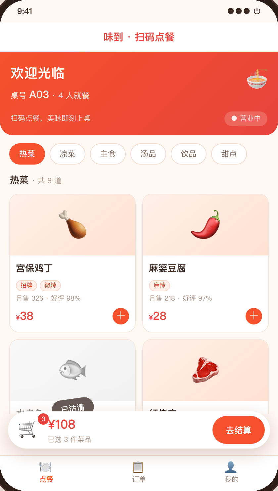
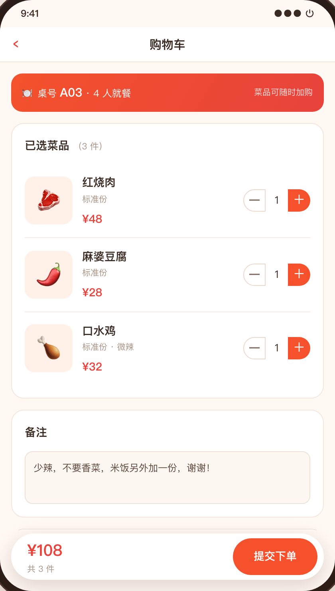
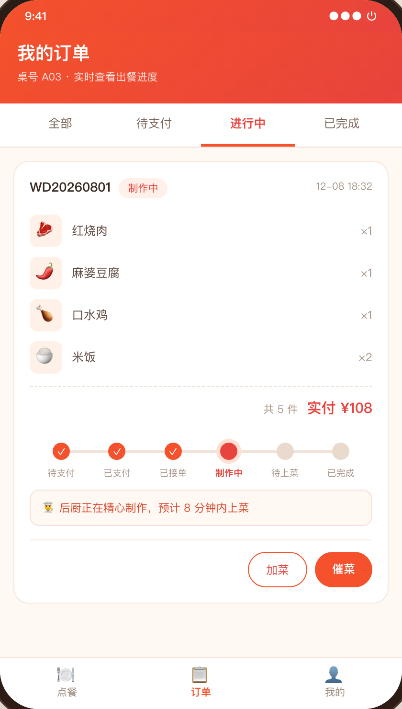
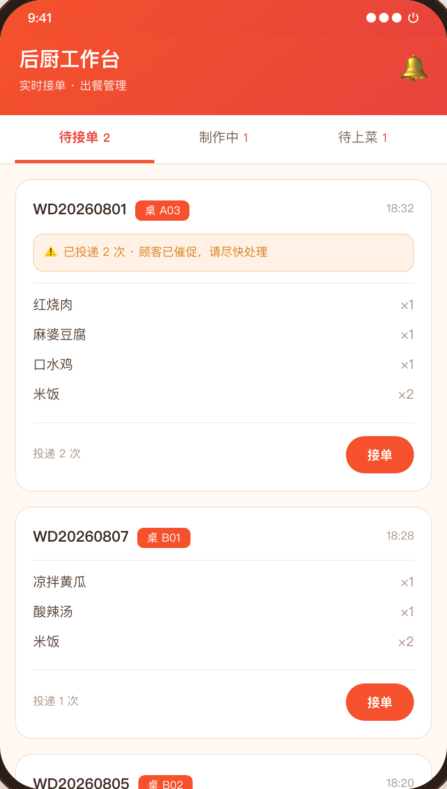
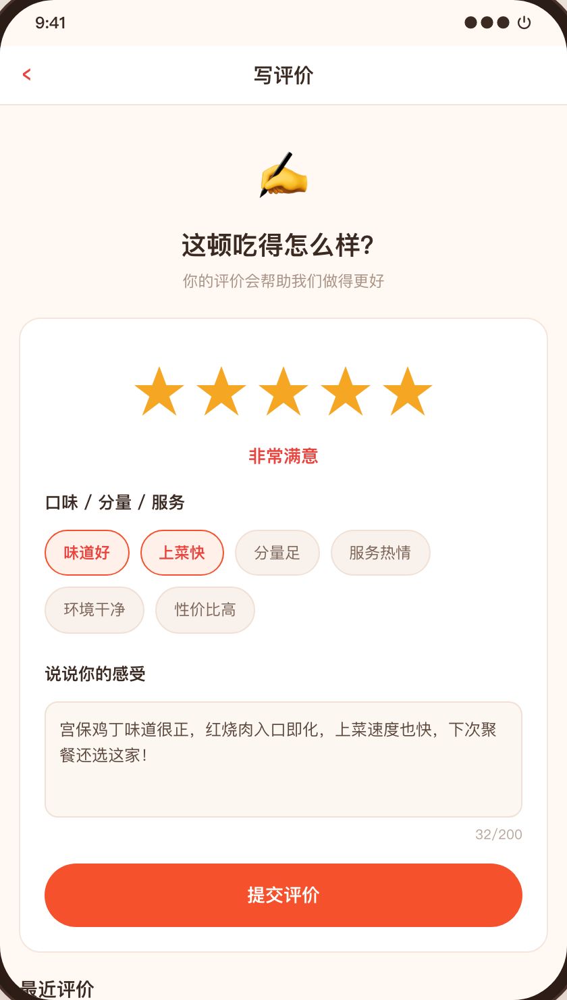
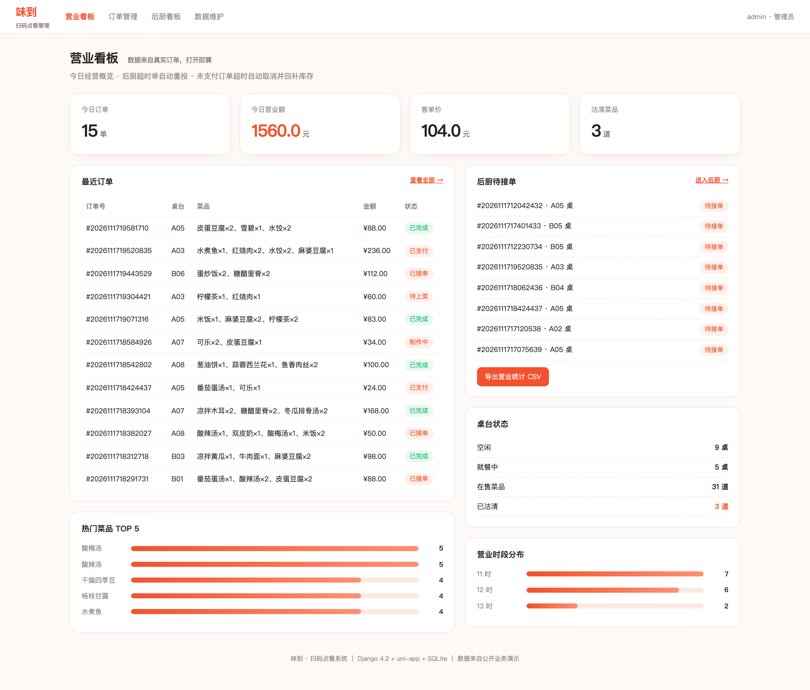
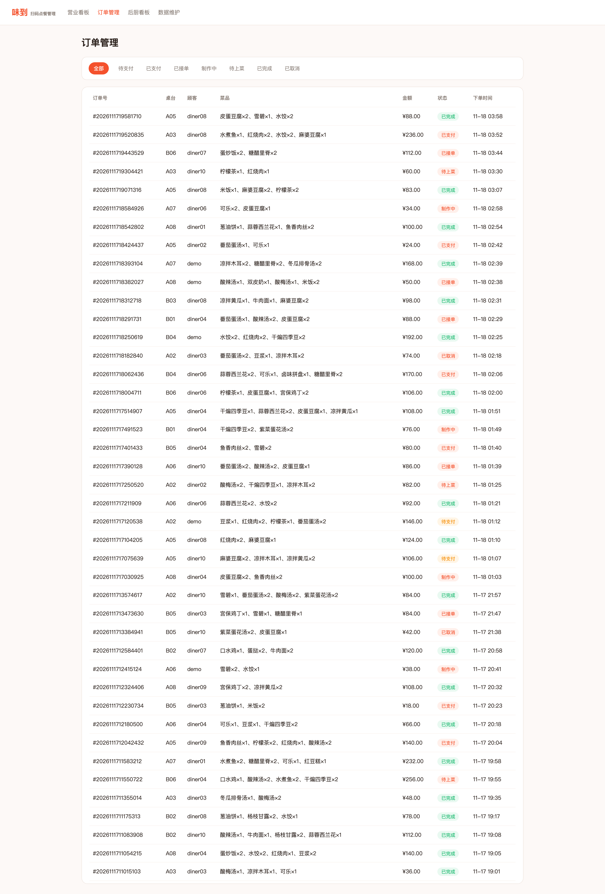
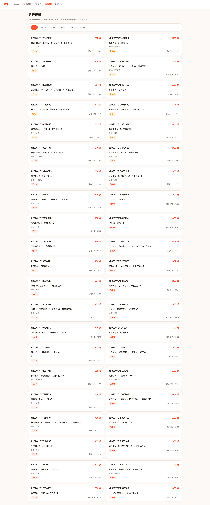

# 039 基于 uni-app 与 Django 的餐厅扫码点餐系统-设计展示

> **代码有偿获取 可接受定制 微信联系方式: csbysj2020 或 ACE2487，备注(BS)**

> **完整源码与全套文档 · 在线自助获取 >>> [https://mbd.pub/o/bread/YZaWl5tvaA==](https://mbd.pub/o/bread/YZaWl5tvaA==)**

> **成品页（功能介绍 / 更多选题）>>> [https://bishe.suilang.net/products/meal-order](https://bishe.suilang.net/products/meal-order)**

> 

> 

## 视频

> **点击查看 >>> [https://www.bilibili.com/video/BV1qBsg6WEXf/](https://www.bilibili.com/video/BV1qBsg6WEXf/)**

## 项目简介

把点餐做成一条可靠链路：扫码带出桌号，下单用行锁校验库存与沽清、不超卖，订单状态机集中管理，后厨单超时自动重投，未支付超时自动取消并回补库存。内置 31 道菜品、6 个分类、14 张桌台，42 笔演示订单合计营业额 4169 元，十项回归测试覆盖锁库存、状态流转与超时回补。

传统中小餐厅的点餐高度依赖纸质菜单与人工传单：顾客翻菜单、喊服务员、手写单、再由服务员送到后厨，过程中常出现写错桌号、漏点菜品、加菜无人记录、催菜靠喊等问题，订单进度无人能实时说清，结算时还要逐项核对。

本项目设计并实现了一套扫码点餐系统，把「浏览菜单—下单—加菜—催菜—结账—评价」搬到顾客手机，把「接单—制作—出餐—沽清」交给后厨看板，把菜品、桌台、订单与营业统计交给管理后台。

系统后端基于 Django 4.2，提供 REST 风格接口（Token 鉴权）与运营后台（session + CSRF）；前端采用 uni-app（Vue 3）实现小程序端，营业统计使用 ECharts 可视化。

本仓库为**设计展示**：包含项目说明、技术架构、实验结果与运行截图；完整源码、任务书、开题报告、毕业论文与使用说明可通过上方链接自助获取，成品页可查看更多选题，也可联系微信咨询定制。

## 功能特性

1. 扫码点餐：扫桌码带出桌号，6 个分类 31 道菜品，沽清即时置灰、不可下单

2. 下单/加菜一致性：select_for_update 锁菜品行，校验库存与沽清，杜绝超卖

3. 订单状态机：pending→paid→accepted→cooking→ready→completed，接口与后台共用同一套规则

4. 后厨可靠投递：attempts 投递次数 + last_push_at，超时未接单自动重投，看板可见超时分钟

5. 超时处理：未支付 15 分钟自动取消、回补库存、释放桌台

6. 三角色：顾客点餐催菜结账评价 / 后厨接单出餐沽清 / 管理员菜品桌台订单营业统计

7. 营业看板：今日订单、营业额、客单价、热门菜品 TOP5、营业时段、桌台状态，导出 CSV

8. 10 项回归测试：锁库存、沽清拒绝、状态流转、加菜、催菜、取消回补、超时取消、后厨重投、评价限制

9. uni-app 六端页面 + 六个 H5 预览页，不装开发者工具也能演示

## 技术架构

| 项目 | 说明 |
| --- | --- |
| 编程语言 | Python 3.8 及以上 |
| Web 框架 | Django 4.2（默认 SQLite，免装数据库） |
| 前端 | uni-app（Vue 3）六页 + H5 预览 |
| 接口 | Django REST 风格接口 + Token 鉴权 |
| 可视化 | ECharts 5（本地引入） |
| 样本规模 | 31 菜品 / 14 桌台 / 42 订单 |
| 运行端口 | http://127.0.0.1:8000 |
| 演示账号 | admin / meals2026（管理员）、kitchen / meals2026（后厨）、demo / demo123456（顾客） |

## 目录结构

以下为完整交付版的结构（本仓库仅作设计展示）：

```
meal-order/
├── 任务书/
│   └── 毕业设计任务书.docx
├── 开题报告/
│   └── 毕业设计开题报告.docx
├── 最终论文/
│   ├── 图/
│   │   └── fig-state.png
│   └── 基于uni-app与Django的餐厅扫码点餐系统设计与实现.docx
├── 源码/
│   ├── canteen/
│   │   ├── management/
│   │   ├── migrations/
│   │   ├── __init__.py
│   │   ├── admin.py
│   │   ├── apps.py
│   │   ├── models.py
│   │   ├── services.py
│   │   ├── tests.py
│   │   ├── urls_admin.py
│   │   ├── urls_api.py
│   │   ├── views_admin.py
│   │   └── views_api.py
│   ├── config/
│   │   ├── __init__.py
│   │   ├── settings.py
│   │   ├── urls.py
│   │   └── wsgi.py
│   ├── data/
│   │   ├── db.sqlite3
│   │   └── stats.json
│   ├── miniprogram/
│   │   ├── images/
│   │   ├── pages/
│   │   ├── utils/
│   │   ├── App.vue
│   │   ├── main.js
│   │   ├── manifest.json
│   │   └── pages.json
│   ├── preview/
│   │   ├── 01-index.html
│   │   ├── 02-cart.html
│   │   ├── 03-orders.html
│   │   └── …
│   └── …
└── …
```

## 数据与实验结论

- 此外，未支付订单超过 15 分钟自动取消并回补库存、释放桌台。
- 在 14 桌、6 分类、31 菜品、42 订单（40 有效）的演示数据上，系统营业额 4169 元、客单价 104.22 元、菜品项 182 条、评价 18 条、沽清 3 道，峰值出现在 18 时；10 项回归测试覆盖锁库存、沽清拒绝、状态流转、加菜、催菜、取消回补、超时取消、后厨重投与评价状态限制，全部通过。
- 扫码点餐：扫桌码带出桌号，6 个分类 31 道菜品，沽清即时置灰、不可下单
- 超时处理：未支付 15 分钟自动取消、回补库存、释放桌台

## 交付内容

1. 完整源码（Django 工程 + uni-app 六页 + 状态机/锁库存/后厨投递模块 + scripts）
2. 演示数据（14 桌 / 31 菜品 / 42 订单）与 SQLite 数据库
3. 一键启动脚本（macOS / Windows）
4. 毕业设计任务书（Word）、开题报告（Word）
5. 毕业论文（Word，七章制，含状态机图与营业看板图）
6. 系统使用与二次开发说明（Word + md，12 节）
7. 8 张界面截图、论文配图、封面、演示视频

## 常见问题

**数据是爬的吗？能更新吗？**

这是业务系统，菜品、桌台、订单由商家自己维护，数据由业务自身产生，不是爬取的外部数据。重跑 python3 manage.py seed 即可重建演示数据，页面与论文数字都会同步。

**下单会不会超卖？**

不会。下单与加菜都用 select_for_update 锁住菜品行，重新校验库存与沽清后才扣减；沽清的菜前台直接置灰，无法下单。

**后厨会不会漏单？**

后厨单记录了投递次数与最近投递时间，超过 5 分钟未接单会自动重投，看板里能看到超时分钟数。

**顾客一直不支付会怎样？**

未支付订单超过 15 分钟自动取消，库存回补、桌台释放。

**能换成 MySQL 吗？**

能。设环境变量 DB_ENGINE=mysql 及 DB_NAME / DB_USER / DB_PASSWORD 后 migrate 即可，默认 SQLite 免安装。

**有哪些角色？**

顾客（扫码点餐、加菜催菜、结账评价）、后厨（接单出餐、状态推进、沽清上报）、管理员（菜品桌台维护、订单管理、营业统计导出）。

## 截图









